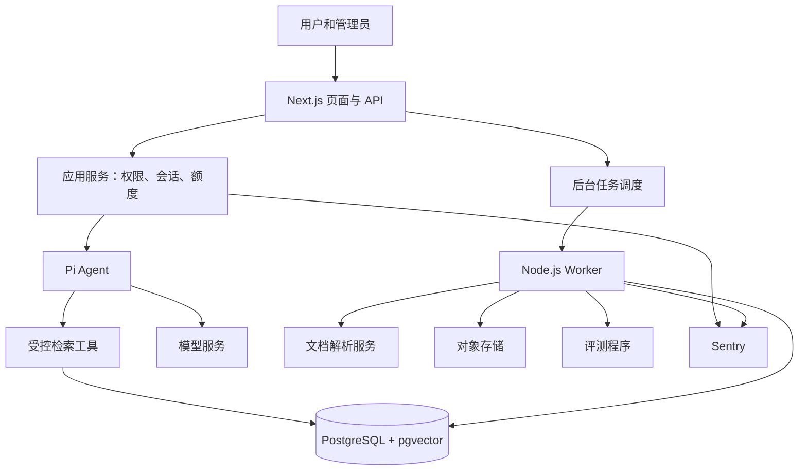

# 系统架构

## 模块关系

业务 API 保持 Next.js，Worker 使用同仓库共享模块。Python 解析服务属于文档处理依赖，不另建业务后端。
Next.js Route Handlers 使用 Node.js runtime。耗时的解析、批量索引和评测独立执行，不绑定网页请求寿命。

## 职责

| 模块 | 职责 |
| --- | --- |
| web | 用户聊天、后台管理、身份检查、HTTP 与流式事件 |
| domain | 规则范围、知识发布、会话、额度等业务约束 |
| db | TypeORM 实体、事务、迁移、参数化检索 SQL |
| agent | Pi 工具、运行预算、答案结构、引用检查 |
| retrieval | 分词、别名、关键词/向量召回、融合、重排、证据补全 |
| evaluations | 标注、开发/保留集、重复实验、报告 |
| worker | 异步任务领取、检查点、重试、资源限制 |
| document-parser | PDF 转结构化来源块 |

## 支撑组件

- TypeORM：业务数据；生产 synchronize=false；专用索引通过 migration 创建。
- pgvector：向量搜索。先精确检索作基线，数据增长后评估 HNSW。
- pg-boss（候选）：调度任务；Worker 是执行任务的代码，不是另一个 Agent。
- 对象存储：原始文件、页面图片、解析产物；不把大文件塞进业务表。
- Swagger：OpenAPI 定义与接口调试。接口请求/响应结构应有统一来源以避免文档漂移。
- Sentry：异常、耗时和调用链；RAG 证据及评测结果仍由业务数据库保存。

## 可靠性与安全边界

权限、版本过滤、额度、引用定位、发布状态由代码保证。模型无任意 SQL、Shell、网络权限。
上传文件限制类型、体积、页数、超时和处理资源；文档文字作为不可信数据，不作为指令。
匿名会话采用安全 Cookie；访问对话时始终校验归属。登录合并匿名历史必须证明原匿名会话归属。
额度原子预占与结算；请求幂等；同一对话生成串行。失败重试不可重复扣费。
生产/测试环境隔离；迁移采用兼容变更；备份恢复必须实际演练。日志不记录凭据和模型内部思维链。

## 可观测性

关联 request_id、run_id、release_id，记录模型/提示词/索引配置、工具调用、分阶段耗时、token 和估算成本。
Sentry 中只附必要标识与脱敏信息。完整对话和证据按应用数据保留策略存储。

## 官方参考

- https://nextjs.org/docs/app/api-reference/file-conventions/route
- https://github.com/earendil-works/pi/tree/main/packages/agent
- https://typeorm.io/docs/migrations/why/
- https://github.com/pgvector/pgvector
- https://github.com/timgit/pg-boss
- https://swagger.io/docs/specification/v3_0/about/
- https://blog.sentry.io/nextjs-export-traces-opentelemetry/
